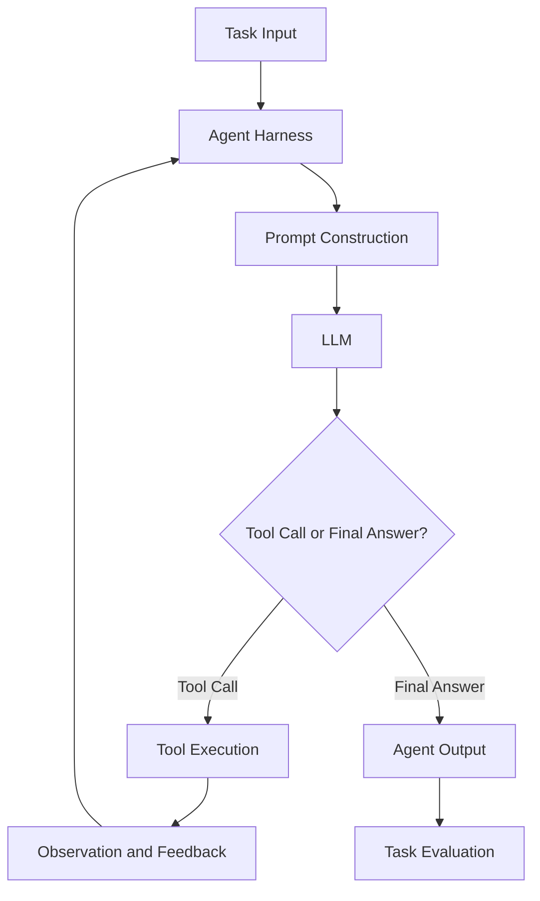
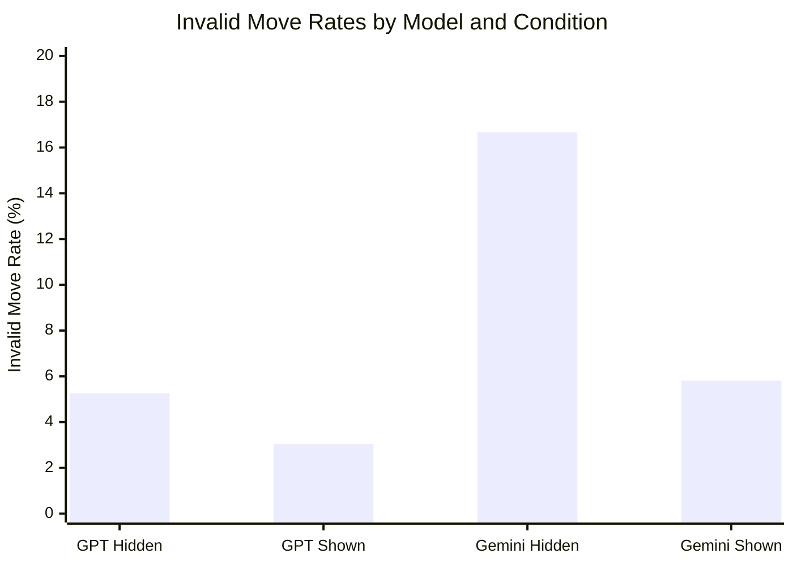

# AI Agent Harness — Implementation & Evaluation

An independent implementation and evaluation project based on
Carnegie Mellon University's 11-768 AI Agents Assignment 1.

## Project Overview

This project explores the design and evaluation of LLM-powered
agents, including code-solving and chess-playing workflows.

The work focuses on agent orchestration, tool interaction,
prompt construction, execution feedback, and evaluation.

## Agent Architecture

The following diagram illustrates the conceptual workflow of the AI agent harness.

The agent harness manages prompt construction, model responses,
tool execution, and feedback.

This diagram is a conceptual overview of the agent workflow.

## My Contributions

I worked on six Python modules covering:

- Agent execution and control flow
- Code agent prompt construction and task handling
- Chess agent behavior and tool integration
- Tool definitions and execution
- Prompt management

The implementation changes are maintained locally.
This repository currently shares project documentation,
experimental observations, and evaluation results.

### Implementation Areas

The implementation work involved six Python modules:

| Module | Technical Focus |
|---|---|
| `agent/base.py` | Agent execution flow, model interaction, and state management |
| `agent/code_agent.py` | Code-solving workflows, prompt construction, and task execution |
| `agent/chess_agent.py` | Chess agent behavior and decision-making |
| `agent/chess_tools.py` | Chess-specific tool interaction and move validation |
| `agent/tools.py` | Tool definitions and execution interfaces |
| `prompts.py` | Prompt templates and agent instructions |

### Engineering and Evaluation

The project involved:

- Implementing and debugging LLM-based agent workflows.
- Investigating tool-calling behavior and execution feedback.
- Experimenting with context compaction to manage long-running tasks.
- Evaluating a Django repair task using the provided SWE-bench checks.
- Comparing invalid-move rates across chess-agent experiments.
- Documenting limitations, unsuccessful attempts, and verified results.

The implementation is maintained locally. This public repository focuses on technical documentation and evaluation rather than redistributing the original starter code.

## Technologies & Concepts

- Python
- Large Language Models (LLMs)
- ReAct-style agent workflows
- Tool Calling
- Agent Harnesses
- SWE-bench task evaluation
- GPT-OSS and Gemini experimentation

## Chess Agent Experiment Visualization

The chart compares observed invalid-move rates across four
completed chess experiments.

**Chart Labels:**

- **GPT Hidden:** GPT-OSS 120B — legal moves hidden.
- **GPT Shown:** GPT-OSS 120B — legal moves visible.
- **Gemini Hidden:** Gemini 3.5 Flash Lite — legal moves hidden.
- **Gemini Shown:** Gemini 3.5 Flash Lite — legal moves visible.

**Interpretation:** Both models showed lower observed invalid-move
rates when legal moves were visible.

Each condition was evaluated using one completed game.
These results are exploratory and do not establish causality.

## Evaluation Results

| Evaluation | Verified Result |
|---|---|
| Chess terminal-move task (Part 1) | 10/10 tests passed |
| SWE-bench Django task (Part 2) | 30/30 tests passed |

These results apply to the specific evaluated tasks and
do not represent performance across the full SWE-bench benchmark.

## Experiments

Additional experiments explored chess-agent behavior using
different LLM configurations, including comparisons involving
legal-move information.

The observations are exploratory and should not be interpreted
as statistically conclusive benchmark results.

## Technical Documentation

The following reports document the implementation process, experimental observations, and evaluation results.

- [Chess Agent Observation Experiment](docs/observation-experiment.md)
- [Token Usage and Context Compaction Analysis](docs/token-usage-analysis.md)
- [AI Tools and Usage Disclosure](docs/AI_USAGE.md)

## Experiment Artifacts

The repository includes selected JSON records from the chess-agent and Django agent experiments.

### Chess Agent — GPT-OSS 120B

| Experiment | Trajectory | Result |
|---|---|---|
| Legal moves hidden | [Trajectory](artifacts/part3-no-legal-moves-gpt-oss.json) | [Result](artifacts/part3-no-legal-moves-gpt-oss-result.json) |
| Legal moves visible | [Trajectory](artifacts/part3-legal-moves-gpt-oss.json) | [Result](artifacts/part3-legal-moves-gpt-oss-result.json) |

### Chess Agent — Gemini

| Experiment | Trajectory | Result |
|---|---|---|
| Legal moves hidden | [Trajectory](artifacts/part3-no-legal-moves-gemini.json) | [Result](artifacts/part3-no-legal-moves-gemini-result.json) |
| Legal moves visible | [Trajectory](artifacts/part3-legal-moves-gemini-retry.json) | [Result](artifacts/part3-legal-moves-gemini-retry-result.json) |

### Django Agent — Context Management

| Experiment | Trajectory |
|---|---|
| Baseline — No compaction | [Trajectory](artifacts/django-baseline-trajectory.json) |
| Compaction v3 | [Trajectory](artifacts/django-compact-v3-trajectory.json) |
| Gemini focused execution | [Trajectory](artifacts/django-gemini-focused-trajectory.json) |

### Django Agent — Verified Repair

A Gemini 3.1 Flash Lite agent generated a patch for the SWE-bench task
`django__django-15368`. The execution recorded 53 agent steps and
4 context compactions.

| Metric | Result |
|---|---|
| FAIL_TO_PASS | 1/1 passed |
| PASS_TO_PASS | 29/29 passed |
| SWE-bench evaluation | **RESOLVED: yes** |

**Supporting artifacts:**

- [Agent trajectory](artifacts/django__django-15368-trajectory.json)
- [Generated patch](artifacts/django__django-15368.patch)
- [SWE-bench evaluation output](artifacts/django-evaluation-output.txt)

These artifacts provide supporting execution records for the documented experiments. They do not, by themselves, establish independent reproducibility or statistically conclusive benchmark performance.

## Implementation Contributions

This project includes modifications to the starter code from
Carnegie Mellon University's 11-768 AI Agents assignment.

The modifications were developed against the upstream
`cmu-agents/assignment-1` commit [`67498d8`](https://github.com/cmu-agents/assignment-1/commit/67498d8).

### Modified Source Files

| File | Area |
|---|---|
| `src/assignment/agent/base.py` | Agent loop and context management |
| `src/assignment/agent/chess_agent.py` | Chess agent implementation |
| `src/assignment/agent/chess_tools.py` | Chess tools |
| `src/assignment/agent/code_agent.py` | Code agent implementation |
| `src/assignment/agent/tools.py` | Agent tools |
| `src/assignment/prompts.py` | Prompt definitions |

The contribution patch contains **690 added lines** and
**141 deleted lines** across six source files.

**[View implementation changes](contributions/my-contributions.patch)**

The patch represents changes relative to the upstream starter code.
It is provided for review and attribution; the upstream project
remains credited to its original authors.

## Original Project & Attribution

This independent project is based on the starter materials
from Carnegie Mellon University's 11-768 AI Agents course.

Original repository:
https://github.com/cmu-agents/assignment-1

Original starter-code authors: Weiwei Sun and Saujas Vaduguru,
with feedback from the CMU 11-768 course staff.

This project is not an official CMU publication or certification.
